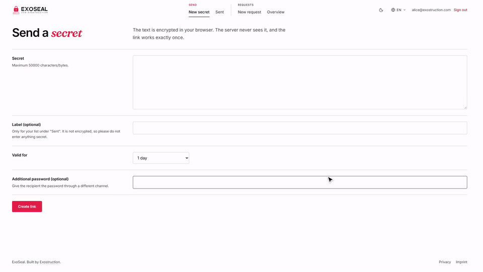
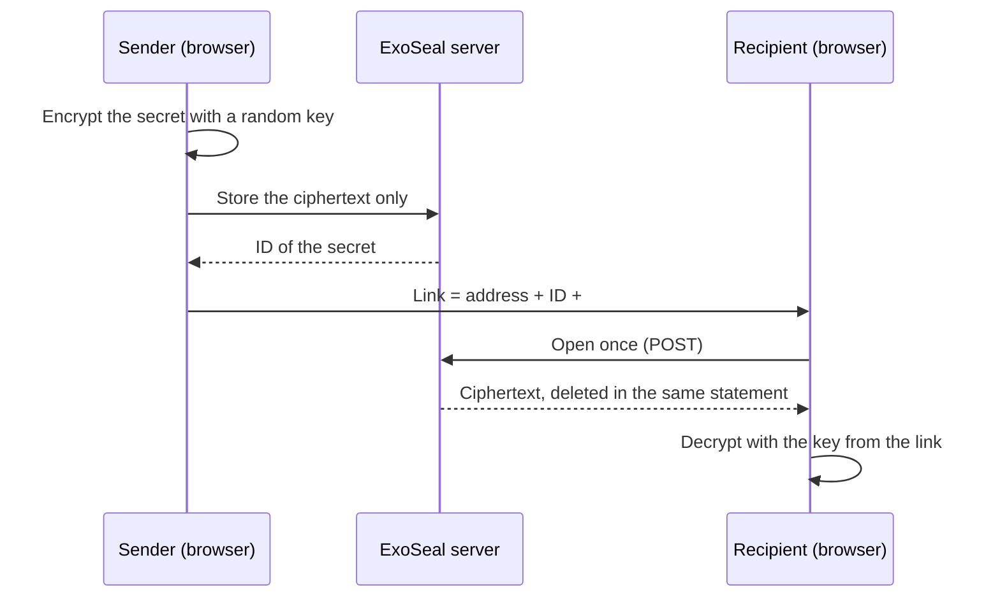
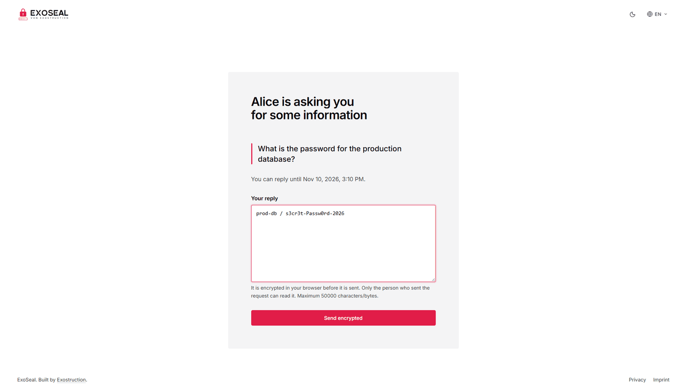
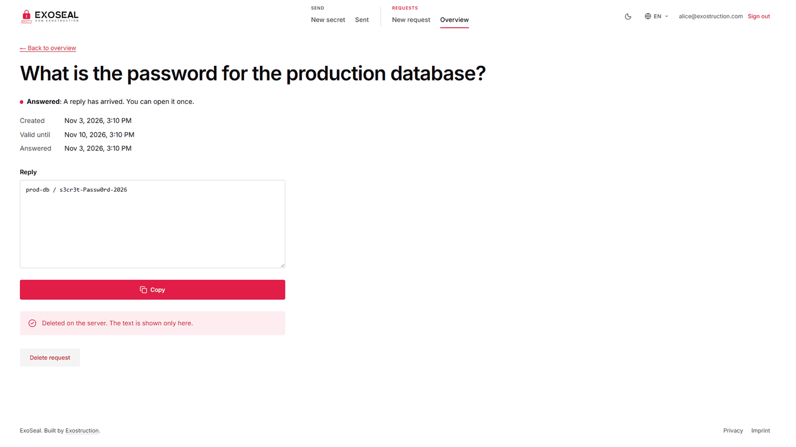

<p align="center">
  
</p>

<h3 align="center">Share secrets that can be read exactly once.</h3>

<p align="center">
  Open source, self-hosted, end-to-end encrypted. The server never sees a plaintext, a key or an IP address.
</p>

<div align="center">

[](LICENSE)
[](https://github.com/Exostruction/Exoseal/actions/workflows/ci.yml)


[**Run it yourself**](#run-it-yourself) &nbsp;·&nbsp; [**How it works**](#how-it-works) &nbsp;·&nbsp; [**Threat model**](docs/THREAT-MODEL.md) &nbsp;·&nbsp; [**Operations**](docs/OPERATIONS.md)

</div>

<p align="center">
  
</p>

## Why ExoSeal

Passwords and tokens end up in chats and mailboxes, where they stay forever. ExoSeal makes a secret travel **once**: it is encrypted
in your browser, you send a link, and the first person to open it reads the secret. Then it is gone for good.

|  |  |
|---|---|
| **Zero knowledge** | Encryption and decryption happen in the browser (AES-GCM, ECDH P-256, PBKDF2). The server stores no plaintext, no key, no IP address and no recipient. |
| **Read once** | One atomic database statement deletes the secret as it is returned. Link-preview bots cannot use it up, because reading is a `POST`. |
| **Request a secret** | Send a customer a link with a question. They answer in their browser, and only you can decrypt it, with a passphrase that never leaves your device. |
| **Your login, your rules** | Sign-in through any OpenID Connect provider with PKCE, limited to the e-mail domains or addresses you allow. Opening a link needs no account. |
| **Abuse protection** | Rate limits per user and per visitor, quotas, origin checks, a strict CSP, and a report button on every link. |
| **Small and boring** | .NET 10 backend, Next.js frontend, PostgreSQL, Valkey, all in Docker. German and English. |

What it protects and what it does not is written down honestly in [docs/THREAT-MODEL.md](docs/THREAT-MODEL.md).

## How it works

The key sits in the part of the link after the `#`. Browsers never send that part to a server.



### Request a secret from someone else

Ask first, receive later. The person you ask needs no account and no software.

<p align="center">
  <picture>
    <source media="(prefers-color-scheme: dark)" srcset="docs/assets/customer-dark.png">
    
  </picture>
</p>

You read the reply once, in your own browser, after entering your passphrase.

<p align="center">
  <picture>
    <source media="(prefers-color-scheme: dark)" srcset="docs/assets/owner-dark.png">
    
  </picture>
</p>

## Run it yourself

You need a server with Docker and Docker Compose, a domain with HTTPS, and an OpenID Connect provider (Google Workspace, Microsoft
Entra, Keycloak, Zoho, Authentik, … anything with PKCE `S256` that returns `sub`, `email` and `email_verified`).

```sh
mkdir exoseal && cd exoseal
curl -O https://raw.githubusercontent.com/Exostruction/Exoseal/main/docker-compose.yml
curl -o .env https://raw.githubusercontent.com/Exostruction/Exoseal/main/.env.example
```

Edit `.env`:

| Setting | What to put there |
|---|---|
| `POSTGRES_PASSWORD` | A long random password. |
| `PUBLIC_URL` | Your address, for example `https://seal.example.com`. |
| `OIDC_METADATA_ADDRESS`, `OIDC_CLIENT_ID`, `OIDC_CLIENT_SECRET` | From your login provider. Register the redirect URI `<PUBLIC_URL>/api/v1/auth/callback` there. |
| `ALLOWED_EMAIL_DOMAINS` and/or `ALLOWED_EMAILS` | Who may create links. Required once login is on. |
| `TRUSTED_PROXY_HOPS` | `1` when exactly one reverse proxy sits in front. Needed for per-visitor rate limits. |
| `EXOSEAL_VERSION` | Pin a release, for example `1.0.0`, instead of `latest`. |

Start it:

```sh
docker compose pull
docker compose up -d
```

The frontend listens on `127.0.0.1:3000` only. Put a reverse proxy in front that terminates TLS. With Caddy this is the whole config:

```
seal.example.com {
    reverse_proxy 127.0.0.1:3000
}
```

Open your address and sign in. [docs/OPERATIONS.md](docs/OPERATIONS.md) covers the client IP and `TRUSTED_PROXY_HOPS` in detail,
backups (**without** the `secrets` table), logs, notifications, the legal pages (`IMPRINT_*`) and abuse reports.

Images are published for `linux/amd64` and `linux/arm64`:
`ghcr.io/exostruction/exoseal-backend` and `ghcr.io/exostruction/exoseal-frontend`.

> [!IMPORTANT]
> The imprint, privacy policy and terms pages in the app are **templates**, written for German law and not reviewed by a lawyer.
> Read them, fill the `IMPRINT_*` settings and have them checked for your situation before you go live.

## Security

Please report vulnerabilities privately, see [SECURITY.md](SECURITY.md). Do not open a public issue for them.

## Development

```sh
docker compose -f docker-compose.yml -f docker-compose.build.yml -f docker-compose.dev-idp.yml up -d --build
```

This builds from source and starts a mock login provider (see [docs/OPERATIONS.md](docs/OPERATIONS.md#local-development-without-an-identity-provider)).

```sh
dotnet test backend                                    # needs TEST_POSTGRES, see CONTRIBUTING.md
cd frontend && corepack yarn install && corepack yarn test
cd e2e && npm ci && npm test                           # whole flow in a browser, needs the stack above
```

See [CONTRIBUTING.md](CONTRIBUTING.md) before opening a pull request.

## License

[GNU AGPL-3.0](LICENSE). If you run a modified ExoSeal as a public service, you must offer your users the source of your version.

The name "ExoSeal" and the logo are not covered by this license. If you publish a fork, please give it its own name and logo.
